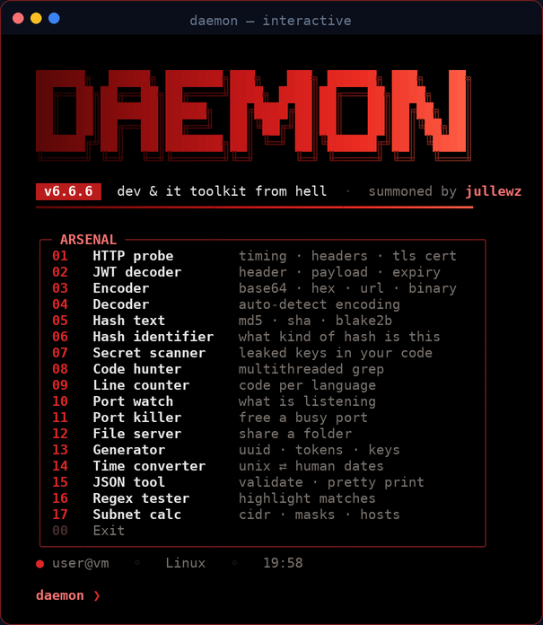
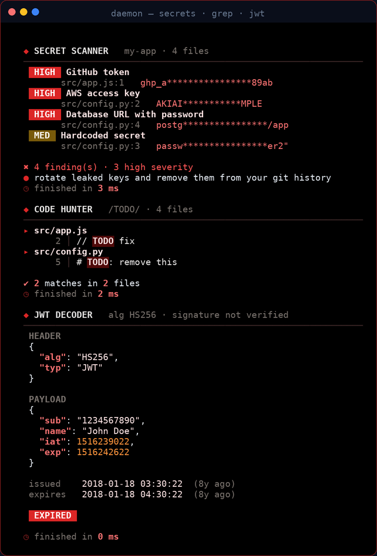
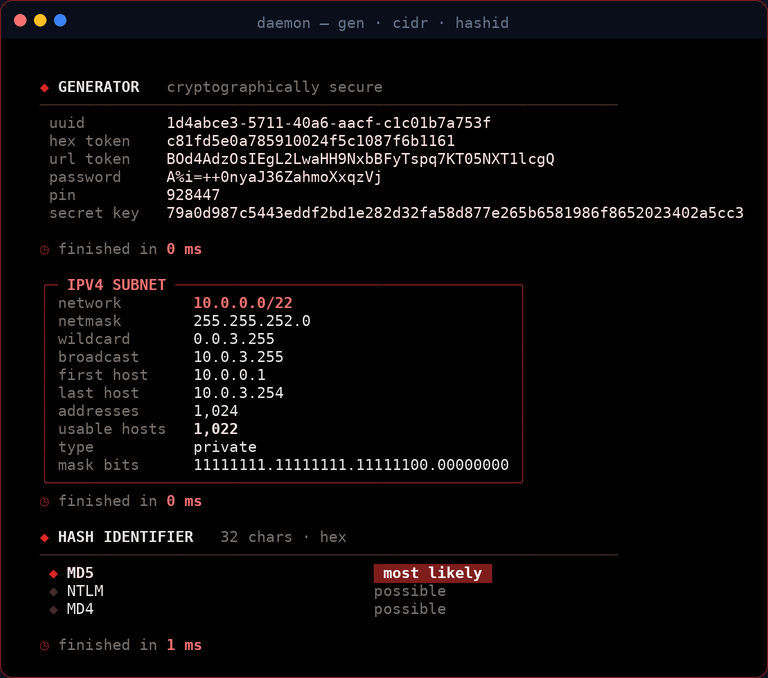

# DAEMON

<p align="center">
  
</p>

**The dev & IT toolkit from hell — summoned by jullewz.**

17 tools every coder and sysadmin reaches for daily, in one file. Pure Python standard library: no dependencies, no install step, runs on Linux and Windows PowerShell. Multithreaded where it matters, black & red full-screen interface.

<p align="center">
  
</p>

## The arsenal

| Command   | What it does                                                          |
|-----------|-----------------------------------------------------------------------|
| `http`    | Probe a URL: timing waterfall, redirects, headers, security headers score, TLS certificate |
| `jwt`     | Decode a JWT: header, payload, issued / expiry times                  |
| `encode`  | base64, base64url, hex, url, html, binary, rot13 — all at once        |
| `decode`  | Auto-detects the encoding and decodes it                              |
| `hash`    | md5, sha1, sha256, sha512, sha3, blake2b of any text                  |
| `hashid`  | Identify a hash type (MD5, SHA, bcrypt, Argon2, Linux shadow…)       |
| `secrets` | Scan code for leaked API keys, tokens, private keys and passwords     |
| `grep`    | Multithreaded regex search through a codebase with highlighted hits  |
| `loc`     | Lines of code per language                                            |
| `ports`   | What is listening on your machine, with process names                 |
| `kill`    | Free a busy port ("port 3000 is already in use")                      |
| `serve`   | Share a folder over HTTP, locally or with your whole network          |
| `gen`     | UUIDs, tokens, passwords, PINs, secret keys                           |
| `time`    | Unix timestamp ⇄ human dates                                          |
| `json`    | Validate, pretty print or minify JSON with the exact error position   |
| `regex`   | Test a regex with highlighted matches and capture groups              |
| `cidr`    | Subnet calculator for IPv4 and IPv6                                    |

Every command prints how long it took.

<p align="center">
  
</p>

## Requirements

Python 3.8 or newer. That's it.

## Install

```bash
git clone https://github.com/jullewz/daemon.git
cd daemon
```

Optional — install it as a `dmn` command you can run from anywhere:

```bash
pip install .
```

## Usage

Run it with no arguments for the interactive menu, or call a tool directly.

### Linux

```bash
python3 daemon.py                                   # interactive menu
python3 daemon.py http github.com
python3 daemon.py secrets ~/projects/my-app
python3 daemon.py grep "TODO|FIXME" . -i
python3 daemon.py loc .
python3 daemon.py ports
python3 daemon.py kill 3000
python3 daemon.py serve . --lan
python3 daemon.py jwt eyJhbGciOi...
python3 daemon.py decode "SGVsbG8gZGVtb24="
python3 daemon.py hashid 5f4dcc3b5aa765d61d8327deb882cf99
python3 daemon.py time 1700000000
cat data.json | python3 daemon.py json -
python3 daemon.py cidr 10.0.0.0/22
```

### Windows PowerShell

```powershell
python .\daemon.py                                  # interactive menu
python .\daemon.py http github.com
python .\daemon.py secrets C:\code\my-app
python .\daemon.py ports
python .\daemon.py kill 3000
python .\daemon.py serve . --lan
Get-Content data.json | python .\daemon.py json -
```

If `python` isn't found, try `py` instead. Use Windows Terminal for the best-looking colors.

### Options

- `--no-banner` hides the banner
- `-v` / `--version` shows the version
- `daemon.py <command> -h` shows every option for a tool
- Set `NO_COLOR` to turn off colors. Output piped to a file or another program is plain text.

### Use the secret scanner in CI

`secrets` exits with code 1 when it finds something, so you can fail a build on leaked keys:

```bash
python3 daemon.py --no-banner secrets .
```

## Notes

- `serve` only listens on your own machine unless you add `--lan`.
- `kill` asks before stopping anything (`-y` skips the question).
- `ports` and `kill` may need admin / sudo to see other users' processes.
- The JWT decoder shows what's inside a token; it does not verify the signature.

## License

MIT © jullewz
